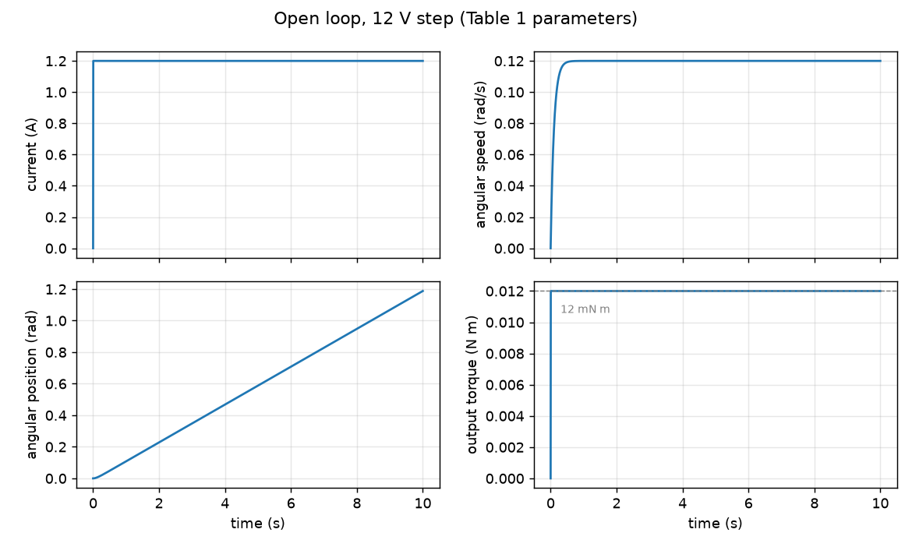
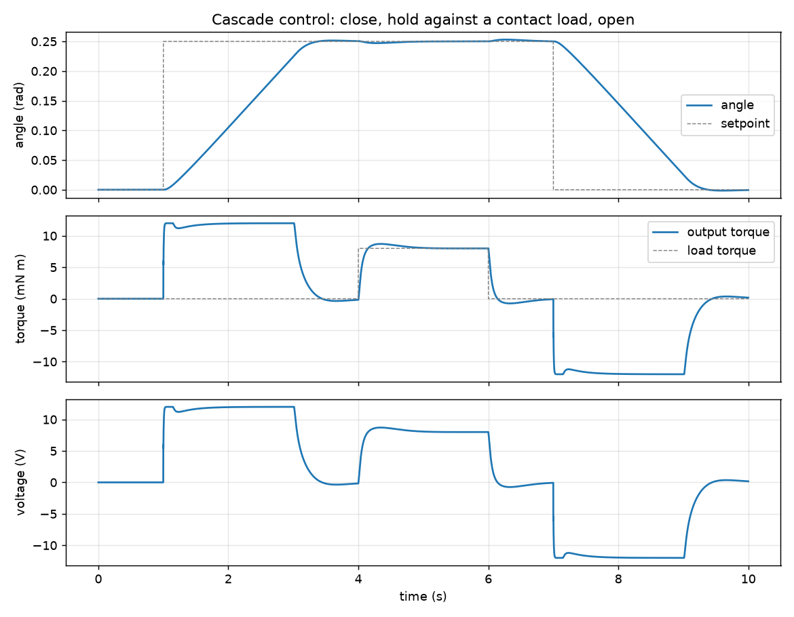

# dc-motor-control-sim

Linear model of a DC motor for the grip movement of an upper-limb prosthesis, with its open-loop simulation and a cascade control loop. Numpy and scipy only.

This is a **public rebuild** of a university course project (Proyecto N°2 SLD): the paper *Aplicación de motor DC para movimiento de agarre en una prótesis ortopédica de miembro superior*, by Francisco Zambrano Salamanca, Eduardo Rodríguez Bunster and Gabriel Torres Cartes. The paper models the motor with differential equations and simulates it in MATLAB/Simulink. This repo reimplements that model and its open-loop simulation in Python with the paper's Table 1 parameters, and implements the cascade control loop that the paper proposes in its Figure 9 but only presents as a block diagram. The Simulink files are not included. It is an educational model, not a design for a real prosthesis or any medical use.



## What it does

1. **Model** (`dcmotor/model.py`): the paper's equations (1) to (4), with R, L, B, J, Km and Ka:
   `L di/dt = v - R i - Ea`, `J dw/dt = Tm - B w`, `Ea = Ka w`, `Tm = Km i`.
   States are current, speed and angle. Outputs are the four signals the paper plots: current, angular speed, angular position and output torque. The default parameters are Table 1 (motor RS-790SH, 42 mm). A load torque input is added; the paper's open-loop model has none.
2. **Open loop** (`dcmotor/response.py`): voltage step over 10 s, the same experiment as the paper's Figures 4 to 7.
3. **Cascade control** (`dcmotor/cascade.py`, `dcmotor/pid.py`): three nested PID loops, position to speed to current to voltage, with a 12 V limit and anti-windup by back-calculation. The output torque is Km times the current, so the inner loop is also the torque loop.
4. **Demo** (`dcmotor/demo.py`): runs both cases and writes the figures in `docs/`.

## Results

**Open loop, 12 V step.** Current and torque jump to a constant value, speed rises with a time constant of J/B = 0.1 s, and the angle grows linearly with no upper bound: the same shapes as the paper's Figures 4 to 7. The torque settles at 12.00 mN m, speed at 0.12 rad/s, and the angle reaches 1.19 rad after 10 s. The paper does not state the step amplitude; I use 12 V because it gives the 12 mN m that its conclusions give as the minimum torque for the task. With no feedback, nothing can stop the motion or reverse it.



**Cascade control.** The setpoint closes the gripper to 0.25 rad at 1 s and opens it at 7 s, with an 8 mN m contact load between 4 s and 6 s.

```
close to 0.25 rad   rise 1.69 s   overshoot 0.6 %   settling 2.23 s   error -0.55 mrad
8 mN m contact      angle dip 2.9 mrad, holding torque 8.00 mN m
open                current reaches -1.20 A (polarity reversal), final angle -0.6 mrad
```

The rise time is set by the motor, not the controller: at 12 V the speed cannot exceed 0.12 rad/s. The current reverses polarity to open the gripper, which is the second phase the paper says open loop cannot achieve.

The paper's Figure 9 shows three PID controllers in cascade with sensor feedback and a torque and current disturbance, without saying what each loop controls. Position, speed and current is my interpretation.

## Run it

```
python -m venv .venv
.venv/Scripts/pip install -r requirements.txt      # Linux/macOS: .venv/bin/pip
.venv/Scripts/python -m pytest
.venv/Scripts/python -m dcmotor.demo               # prints the results and writes docs/*.png
```

## Limits

- Parameters are those of the paper's Table 1; I have not checked them against the RS-790SH datasheet. The paper's Figure 1 labels the inductance 10 µH while Table 1 lists 1000 µH; this repo uses the table. In the 12 V step the difference changes the current by less than 3e-7 A.
- The 12 V step, the load torque and the whole cascade are not in the paper's simulation; they are additions in this rebuild.
- The angle is the motor shaft angle: no gearbox, no hand mechanism and no grip force model.
- Linear model. It ignores gearbox backlash, friction that depends on speed, current limits other than the 12 V supply, and temperature.
- The controller gains were tuned by hand for this motor; they are not optimal.
- Sensor noise, quantization and delays are not modeled.
- Not a control design for clinical use.

MIT license.
