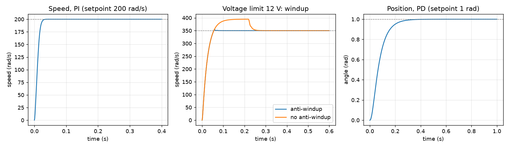
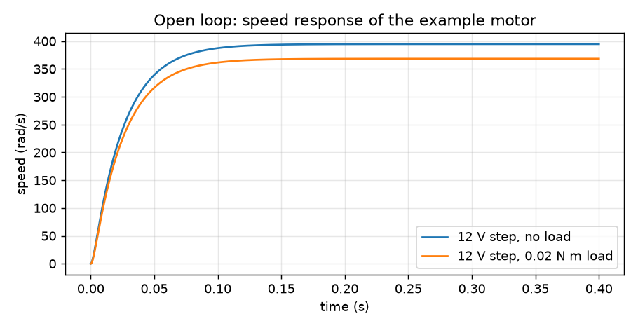

# dc-motor-control-sim

Linear model of a DC motor and simulation of its speed and position control in Python. Numpy and scipy only.

I modeled DC motors as linear dynamic systems in MATLAB/Simulink for mobile prostheses. This repo is a **public rebuild** of that work, developed together with Eduardo Rodríguez Bunster: a new, independent implementation in Python with **example parameters**, no prosthesis data and none of the original models. It is an educational model, not a design for a real prosthesis or any medical use.



## What it does

1. **Model** (`dcmotor/model.py`): state-space and transfer-function model of a brushed DC motor from its electrical and mechanical parameters (resistance, inductance, inertia, friction, torque and back-EMF constants). States are current, speed and angle; inputs are voltage and load torque.
2. **Open-loop response** (`dcmotor/response.py`): step response with and without a load torque, poles, and the usual metrics (rise time, overshoot, settling time, steady-state error).
3. **Control** (`dcmotor/pid.py`): discrete PID for speed or position on a zero-order-hold plant, with a 12 V voltage limit, a filtered derivative on the measurement, and optional anti-windup by back-calculation.
4. **Demo** (`dcmotor/demo.py`): runs the cases below and writes the figures in `docs/`.



## Results (example motor, 1 ms sample time)

The example motor has a DC gain of 32.9 rad/s per volt and poles at -40.7 and -559.8 rad/s. With 12 V it reaches about 395 rad/s.

```
case                                            rise (s)  overshoot %  settling (s)  ss error
Speed PI, 200 rad/s                                0.016         0.02         0.025    -0.000
Speed PI saturated, 350 rad/s, anti-windup         0.038         1.08         0.052     0.000
Speed PI saturated, 350 rad/s, no anti-windup      0.038        12.77         0.240    -0.000
Position PD, 1 rad                                 0.137         0.00         0.253     0.000
```

With a large setpoint the voltage saturates at 12 V. Without anti-windup the integral keeps growing and the speed overshoots by 12.8 % before recovering; with back-calculation the overshoot is 1.1 %. A 0.02 N m load applied at 0.4 s is rejected back to the setpoint by the speed PI.

## Run it

```
python -m venv .venv
.venv/Scripts/pip install -r requirements.txt      # Linux/macOS: .venv/bin/pip
.venv/Scripts/python -m pytest
.venv/Scripts/python -m dcmotor.demo               # prints the table and writes docs/*.png
```

## Limits

- Example parameters, not those of a real motor or prosthesis. Replace the `Motor` fields with your own.
- Linear model. It ignores gearbox backlash, friction that depends on speed, current limits and temperature.
- The controller gains were tuned by hand for this example motor; they are not optimal.
- Sensor noise, quantization and delays are not modeled.
- Not a control design for clinical use.

MIT license.
